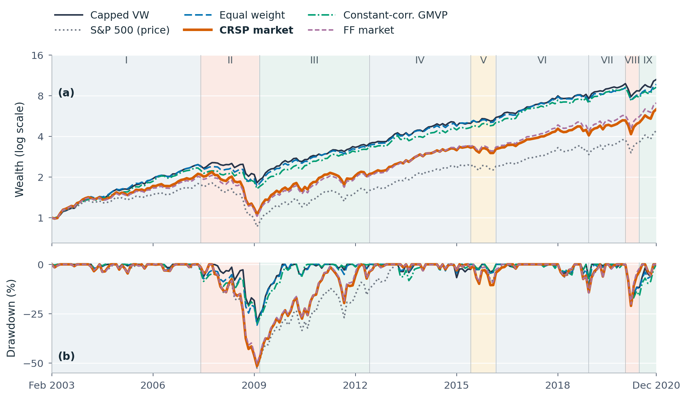

# Low-Risk and Coskewness-Based Stock Selection

### The Incremental Value of Portfolio Optimization

**Team 4 · Introduction to Financial Engineering (INE3083) · Hanyang University · Fall 2026**

[Report](paper/report.pdf) · [Quick-start notebook](notebooks/01_quickstart.ipynb) · [Full reproduction](notebooks/02_reproduce_report.ipynb) · [Data inventory](data/README.md)

This repository reproduces the final report's comparison of **19 allocation rules on the same 30 selected stocks**, using 36-month estimation windows and 215 holding months from February 2003 through December 2020. It includes the original inputs, fixed selection files, numerical reference results, report source, and executable examples.

The experiment asks whether portfolio optimization adds value **conditional on a supplied low-risk and negative-coskewness selection**. Market-capitalization weighting has the highest CAGR; the small Sharpe advantage of Ledoit–Wolf identity shrinkage does not establish a statistically significant improvement. The repository also reproduces the report's defensive-versus-return-oriented selection comparison.



## Reproduce the results

### 1. Clone the code and data

Install Git LFS before cloning. Six large input files are stored with Git LFS; ordinary pointer files are insufficient to run the experiment.

```bash
git lfs install
git clone https://github.com/swp-wooki/-INE3083_FALL_2026-Term-Project_Team-4.git
cd -- -INE3083_FALL_2026-Term-Project_Team-4
git lfs pull
python3 scripts/verify_data.py
```

The packaged data occupy approximately 353 MiB; the original inputs total about 1.83 GiB before lossless compression. Allow additional space for the Git LFS cache, Python environment, and generated outputs. Checksums verify both the stored files and the exact original bytes of newly compressed inputs. No market-data download is performed at runtime.

### 2. Create the Python environment

Python **3.13** is the reference version; the package requires Python 3.11 or later. Direct dependency versions are pinned in `requirements.txt`.

```bash
python3 -m venv .venv
source .venv/bin/activate
python -m pip install -r requirements.txt
```

On Windows, activate with `.venv\Scripts\activate` instead. Run the commands below from the repository root. Install this checkout in editable mode as shown above so the package can locate the adjacent data and report directories.

### 3. Inspect the results in Jupyter

```bash
python -m jupyter lab notebooks/01_quickstart.ipynb
```

The quick-start notebook loads the supplied results, checks the fixed universe and cost identity, draws performance curves, and computes a new allocation from an actual 36-month raw-data window. It does not rerun all 19 strategies. `02_reproduce_report.ipynb` executes the complete pipeline and compares its outputs with the supplied reference.

### 4. Run the full report experiment

The report builder requires a TeX distribution containing **BibTeX and IEEEtran.bst**. PDF compilation additionally requires `pdflatex`, IEEEtran, and PGFPlots. Python-only experimentation and the quick-start notebook do not require TeX.

```bash
python -m lowrisk_portfolio.cli
python scripts/compare_reference.py
```

The pipeline runs allocation, exposure and cost decomposition, the 30-versus-50-stock comparison, report tables and figures, market inference, and benchmark checks. New results go to `results/reproduced/`; `results/reference/` remains unchanged. Full execution may take several minutes or longer depending on the solver and hardware.

```bash
# Also compile the regenerated report.
python -m lowrisk_portfolio.cli --pdf

# Redraw the three main figures from supplied tables without re-estimating weights.
python -m lowrisk_portfolio.cli --figures-only --output results/figure_example

# Run only the allocation stage, without TeX.
python -m lowrisk_portfolio.experiment
```

The optional `--certify` flag regenerates independent numerical certificates, including exhaustive vertex checks for negative-numerator maximum-Sharpe problems. It requires a C++17 compiler available as `clang++` and can take substantially longer than the main pipeline. Existing regression checks run with:

```bash
python -m unittest discover -s tests -q
```

## Reference results

Full sample, February 2003–December 2020. Strategy returns include one-way trading costs of 10 basis points; indices are uncosted. Values below are rounded from `results/reference/model_metrics.csv` and `benchmark_metrics.csv`.

| Allocation / benchmark | CAGR | Annual volatility | Sharpe | Maximum drawdown |
|:--|--:|--:|--:|--:|
| Market-cap weight | 14.05% | 11.39% | 1.110 | −29.00% |
| Equal weight | 13.52% | 11.18% | 1.087 | −30.77% |
| LW identity GMVP | 13.48% | 10.82% | 1.114 | −31.16% |
| Constant-correlation GMVP | 13.20% | 11.08% | 1.069 | −29.87% |
| S&P 500 price benchmark | 8.61% | 14.30% | 0.566 | −52.56% |
| Broad value-weighted total-return benchmark | 10.86% | 14.93% | 0.687 | −51.48% |
| Fama–French market | 11.54% | 14.83% | 0.732 | −50.31% |

The S&P 500 series excludes dividends. Its difference from strategy returns is therefore not a dividend-matched premium. No mean-return advantage over market-capitalization weighting survives the report's multiple-comparison adjustment. See the report for paired inference, market regimes, cost sensitivities, and interpretation.

## Experimental protocol

- **Fixed selections:** 30 stocks per month; all 19 allocations use exactly the same constituents. The supplied formation-month ranking is preserved. The separate selection comparison uses 30 and 50 stocks and therefore changes both constituents and portfolio size.
- **Timing:** formation information at month `t` determines holdings in `t+1`. Estimation uses the 36 observed months ending at formation. Required missing estimation or holding returns stop the experiment.
- **Constraints:** weights sum to one, short selling is prohibited, and the primary position limit is `2/30`. Recorded source weights are projected only to reconcile rounding with those constraints.
- **Returns:** observed monthly total returns, including restored terminal observations. No clipping, price-return fallback, or missing-return imputation enters the primary strategy returns. Missing metadata remain missing as in the final report.
- **Costs:** traded notional is the sum of absolute changes from drifted prior weights. `net_return = (1 − 0.001 × traded_notional) × (1 + gross_return) − 1`. Initial investment incurs costs; terminal residual wealth moves to cash. Sensitivity uses the same target paths at 0, 10, 25, 50, 75, and 100 basis points one way.
- **Inference:** HAC with four lags, Holm adjustment, and paired circular block bootstrap. Seeds and settings are recorded in the resulting tables and manifests.

| Family | Included allocation rules |
|:--|:--|
| Benchmarks | Recorded market-cap weight; equal weight |
| Covariance-based GMVP | Sample; constant correlation; LW constant correlation; LW identity; RMT clipping; QIS; ridge; FF5 factor covariance |
| Risk allocations | Inverse volatility; constrained risk budgeting; maximum diversification; inverse variance |
| Alternative objectives | Bayes–Stein maximum Sharpe; minimum CVaR; GMVP–1/N mixture; norm-constrained GMVP; transaction-cost GMVP |

## Repository layout

```text
data/                       Original inputs, supplied prepared data, selections, checksums
src/lowrisk_portfolio/       Loading, allocation, accounting, inference, and report generation
src/lowrisk_portfolio/optimizers/
                            Covariance estimators and constrained allocation methods
notebooks/                  Executed quick-start and full-reproduction examples
scripts/                    Input integrity and reference-result comparison
tests/                      Numerical regression checks
results/reference/          Supplied final-report tables and figures
results/validation/         Recorded reproduction checks, certificates, and environment
results/reproduced/          Generated outputs; excluded from version control
paper/                      Supplied final report, LaTeX source, and bibliography
selection/                  Original selection-generation code (rebuilds data/selections/)
```

The supplementary company-fundamentals source is included intact, but the final conditional-allocation experiment does not consume it. Earlier exploratory benchmarks and slide-production files are outside this package's scope.

## Reproducibility scope

The allocation experiment begins with the supplied monthly selection files. The code that generated those selections and its inputs, including the daily beta file, are in [`selection/`](selection/README.md) and `data/selection_inputs/`. Running `python selection/export_selection_b.py` and `python selection/export_selection_momentum.py` reproduces both selection files byte for byte. The code that aggregated CRSP daily records into `daily_signals.csv` was not kept, so that file is an input. The package reproduces allocation and evaluation conditional on the selections. It does not establish a causal selection premium.

The supplied reference tables are retained independently of generated outputs. `scripts/compare_reference.py` checks table keys, numeric values, and nonnumeric fields with documented floating-point tolerances. The provided report remains the reference artifact; a new build writes a separate report under the output directory. The data inventory documents source provenance despite using descriptive filenames.

### Validation record

The packaged version was checked in a fresh environment with Python 3.13.2 and the pinned dependencies. Both notebooks executed without errors; 16 regression tests, 52 benchmark checks, all 12 numerical-reference comparisons, and independent verification of 645 solver cases passed. Six negative-numerator cases were checked by exhaustive vertex enumeration. The regenerated report compiled successfully. Detailed checks, source and input fingerprints, and installed package versions are recorded in [`results/validation/`](results/validation/).

The local NumPy/BLAS runtime emitted matrix-operation warnings during some calculations. These were retained in execution logs; independent formula, accounting, and solver checks passed. Other platforms can have small floating-point differences, which the reference comparison checks using explicit tolerances.

## Citation

Team 4. *Low-Risk and Coskewness-Based Stock Selection: The Incremental Value of Portfolio Optimization*. Introduction to Financial Engineering, Hanyang University, 2026. This is a course research project; no conference publication is claimed.
